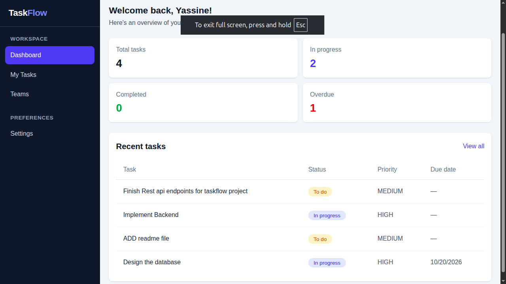
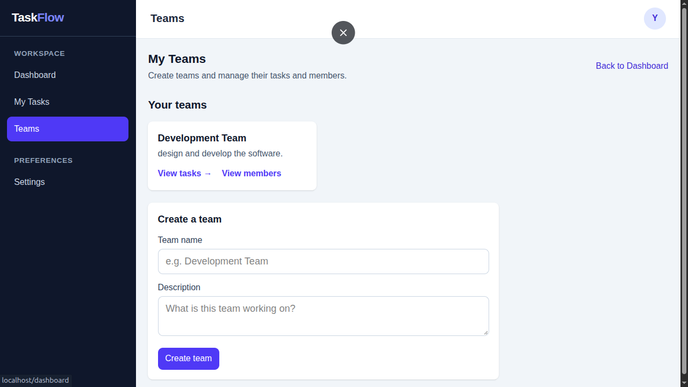
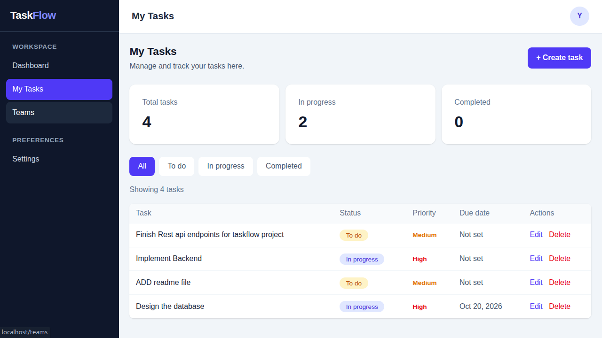

# TaskFlow

**A full-stack team task management application built with React, Spring Boot, and PostgreSQL.**

TaskFlow is a personal portfolio project developed to explore full-stack application engineering, from designing a REST API and relational data model to building a React interface and deploying the application.

It allows users to organize work into teams, manage team membership, and create and track tasks associated with a team.

**Live demo:** https://taskflow-frontend-yt3k.onrender.com

**Repository:** https://github.com/losikkdjhbejs/taskflow

---

## Features

- **Authentication** — Register an account and sign in.
- **Team management** — Create teams and manage their membership.
- **Task management** — Create, view, update, and delete tasks.
- **Task organization** — Associate tasks with teams.
- **Task status and priority** — Organize work using task statuses and priority levels.
- **Protected resources** — Require authentication for protected application endpoints.
- **Persistent storage** — Store application data in PostgreSQL.
- **Containerized development** — Run the application and its dependencies with Docker Compose.

## Screenshots

### Dashboard
An overview of the workspace, including task statistics and recent activity.



### Teams
Manage teams and organize collaboration.



### Tasks
Create, track, and manage tasks associated with a team.



## Technology Stack

| Layer | Technologies |
|---|---|
| Frontend | React, JavaScript, Tailwind CSS |
| Backend | Java 25, Spring Boot |
| API | REST, JSON, Spring Security |
| Authentication | JWT, BCrypt |
| Database | PostgreSQL |
| Database migrations | Flyway |
| Persistence | Spring Data JPA, Hibernate |
| Containerization | Docker, Docker Compose |
| Frontend web server | Nginx |
| Deployment | Render |

## Architecture

TaskFlow separates the frontend, backend, and database into distinct components.

```text
                   User's Browser
                         |
                         v
               React + Tailwind CSS
                         |
                         | HTTP / JSON
                         v
                Spring Boot REST API
                         |
                Spring Security + JWT
                         |
                         v
                  Spring Data JPA
                         |
                         v
                     PostgreSQL
```

The frontend communicates with the backend through REST endpoints. The backend handles authentication, authorization, application logic, and persistence.

PostgreSQL stores application data, while Flyway manages database schema migrations.

For local development, Docker Compose runs the database, backend, and frontend as separate services. Nginx serves the built frontend and proxies API requests to the backend.

The hosted deployment uses a Render Static Site for the frontend, a Render Web Service for the backend, and a PostgreSQL database.

## Running Locally

### Prerequisites

Install the following tools:

- Docker Engine
- Docker Compose

The backend Docker image uses Java 25, and the frontend build uses Node.js 22 through its Dockerfile. You do not need to install those runtimes locally when running the application entirely through Docker Compose.

### 1. Clone the repository

```bash
git clone https://github.com/losikkdjhbejs/taskflow.git
cd taskflow
```

### 2. Configure environment variables

Create a `.env` file in the project root.

```dotenv
DB_NAME=taskflow
DB_USER=taskflow
DB_PASSWORD=replace_with_a_local_database_password
JWT_SECRET=replace_with_a_strong_base64_encoded_secret
```

Use a strong, randomly generated JWT secret encoded as Base64. The decoded key must be suitable for HS256 signing.

For example, you can generate a local secret with:

```bash
openssl rand -base64 32
```

Use the generated value for `JWT_SECRET`.

These values are examples for local development. Never commit real passwords, signing keys, or other secrets to the repository.

### 3. Start the application

```bash
docker compose up --build
```

Docker Compose builds the application images, starts PostgreSQL, waits for the database health check, and starts the backend and frontend services.

Once the services have started, open:

**http://localhost**

The frontend is exposed on port 80. PostgreSQL is bound to `127.0.0.1:5432` on the host for local access.

To stop the application:

```bash
docker compose down
```

To stop the application without removing the database volume, use the command above. To remove the persistent database volume as well, Docker Compose supports:

```bash
docker compose down -v
```

**Warning:** The `-v` option deletes the Compose-managed database volume and its local data. Use it only when you intentionally want to reset the local database.

## Configuration

The backend uses environment variables to configure its database connection and JWT signing key.

| Variable | Purpose |
|---|---|
| `DB_HOST` | PostgreSQL hostname used by the application configuration |
| `DB_NAME` | PostgreSQL database name |
| `DB_USER` | PostgreSQL username |
| `DB_PASSWORD` | PostgreSQL password |
| `JWT_SECRET` | Base64-encoded JWT signing secret |
| `CORS_ALLOWED_ORIGIN` | Permitted frontend origin |

In the Docker Compose environment, the backend's database URL is supplied through `SPRING_DATASOURCE_URL`, using the Compose service hostname `postgres`.

For the hosted frontend, `VITE_API_URL` identifies the backend base URL at build time. Frontend environment variables prefixed with `VITE_` are public and must not contain secrets.

The root `.env` file is intended for local configuration and should not be committed.

## API Overview

The backend exposes a versioned REST API under `/api/v1`.

| Resource | Purpose |
|---|---|
| `/api/v1/auth/register` | Register an account |
| `/api/v1/auth/login` | Authenticate a user |
| `/api/v1/teams` | Team-related operations |
| `/api/v1/tasks` | Task-related operations |

The API uses JSON for request and response bodies. Protected operations require valid authentication, and access to team resources is subject to backend authorization.

Refer to the backend controllers and security configuration for the precise HTTP methods, request schemas, validation rules, and authorization requirements.

## Database and Migrations

TaskFlow uses PostgreSQL for persistent storage and Flyway to manage schema migrations.

Hibernate is configured to validate the database schema rather than automatically update it. This keeps schema changes explicit and allows migrations to be managed as part of the application's source code.

## Deployment

The application is deployed on Render:

- **Frontend:** https://taskflow-frontend-yt3k.onrender.com
- **Backend:** https://taskflow-backend-n2w1.onrender.com

The frontend is deployed as a Static Site, while the backend runs as a separate web service connected to PostgreSQL.

The hosted environment uses environment variables for deployment-specific configuration. Local Docker Compose settings and hosted service settings are configured separately.

The live demo may experience delays when the backend starts after a period of inactivity, depending on the hosting plan.

## Engineering Focus

This project was built as a hands-on exercise in full-stack software engineering, including:

- Designing and consuming REST APIs.
- Building a React frontend connected to a Spring Boot backend.
- Implementing authentication and protected resources.
- Modeling relational data and managing schema migrations.
- Running multiple services with Docker Compose.
- Separating local configuration from hosted deployment configuration.
- Deploying a full-stack application to a cloud hosting platform.

The focus is on understanding how the frontend, backend, database, and deployment environment work together as one application.

## Future Improvements

Potential areas for further development include:

- Expanding automated backend and frontend testing.
- Improving deployment monitoring and operational visibility.
- Strengthening API documentation.
- Reviewing production security and recovery procedures.

---

**Built as a software engineering portfolio project.**